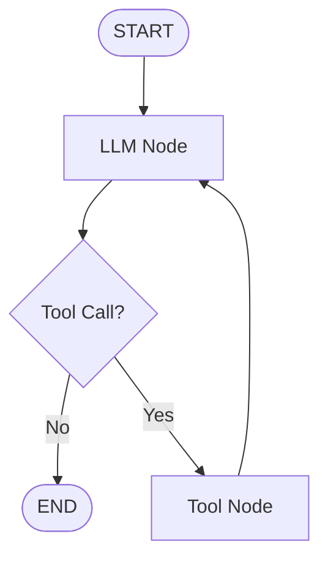
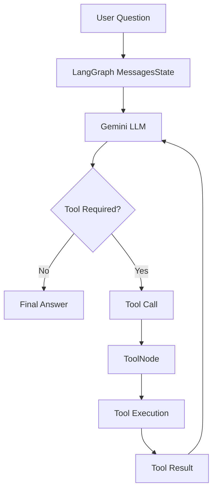

# Project AKRS - Agentic Knowledge Research System

A learning-focused agentic AI project built progressively using LangGraph.

## Phase 0 — Project Foundation

Implemented:

- Python virtual environment
- LangGraph setup
- Basic LangGraph State
- Node
- START and END
- Graph compilation
- Graph invocation

### Current Workflow

START → hello_node → END

## Phase 1 — First LLM Agent

Implemented:

- Gemini LLM integration
- LangChain Chat Model
- Environment variable based API key configuration
- LangGraph State
- LLM node
- Graph invocation
- Basic question-answer workflow

### Current Workflow

START → LLM Node → END

### Flow

User Question
↓
LangGraph State
↓
LLM Node
↓
Gemini
↓
AI Response

## Phase 2 — LLM Tool Calling & Agent Loop

Implemented:

- LangGraph `MessagesState`
- LangChain tool creation using `@tool`
- Gemini tool binding using `bind_tools()`
- `ToolNode`
- `tools_condition`
- Conditional graph routing
- LLM → Tool → LLM loop
- Calculator tool execution
- Tool result passed back to the LLM
- Final AI response generation

### Current Workflow

### Agent Flow

### Performance Observation

During testing with OpenRouter:

Normal LLM query: ~1.9 seconds with a single LLM call.

Tool-calling query: ~5.1 seconds with two LLM calls.

Tool calling introduces additional latency because the agent requires an additional LLM round-trip after tool execution.

### Example:

Normal Query
User → LLM → Final Answer
~1.9 seconds

Tool Query
User → LLM → Tool → LLM → Final Answer
~5.1 seconds

This demonstrates the additional inference overhead introduced by the agentic tool-calling loop.