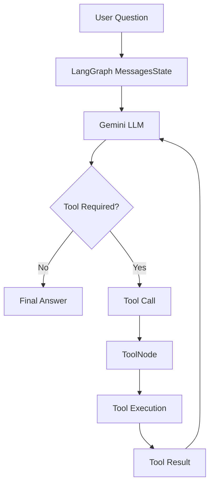
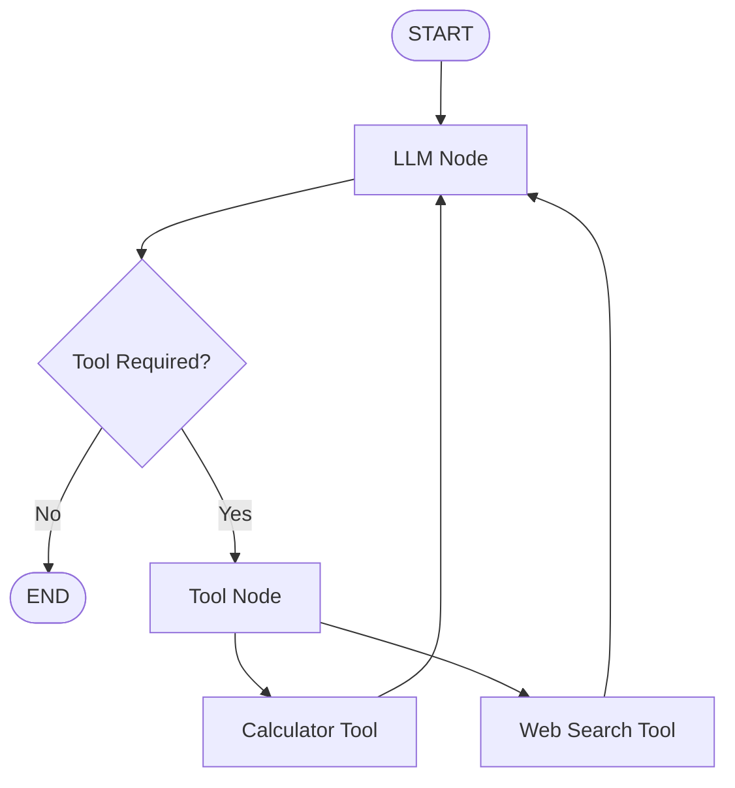

# Project AKRS - Agentic Knowledge Research System

A learning-focused agentic AI project built progressively using LangGraph.

## Phase 0 — Project Foundation

Implemented:
- Python virtual environment
- LangGraph setup
- Basic LangGraph State
- Node
- START and END
- Graph compilation
- Graph invocation

### Current Workflow
START → hello_node → END


## Phase 1 — First LLM Agent

Implemented:
- Gemini LLM integration
- LangChain Chat Model
- Environment variable based API key configuration
- LangGraph State
- LLM node
- Graph invocation
- Basic question-answer workflow

### Current Workflow
START → LLM Node → END

### Flow
User Question
↓
LangGraph State
↓
LLM Node
↓
Gemini
↓
AI Response


## Phase 2 — LLM Tool Calling & Agent Loop

Implemented:
- LangGraph `MessagesState`
- LangChain tool creation using `@tool`
- Gemini tool binding using `bind_tools()`
- `ToolNode`
- `tools_condition`
- Conditional graph routing
- LLM → Tool → LLM loop
- Calculator tool execution
- Tool result passed back to the LLM
- Final AI response generation

### Current Workflow


### Agent Flow



### Performance Observation
During testing with OpenRouter:
- **Normal LLM query:** ~1.9 seconds with a single LLM call.
- **Tool-calling query:** ~5.1 seconds with two LLM calls.

Tool calling introduces additional latency because the agent requires an additional LLM round-trip after tool execution.

#### Latency Example:
* **Normal Query:** User → LLM → Final Answer (~1.9 seconds)
* **Tool Query:** User → LLM → Tool → LLM → Final Answer (~5.1 seconds)

This demonstrates the additional inference overhead introduced by the agentic tool-calling loop.


## Phase 3.1 — Web Search Tool

The agent was extended with a real web search capability using the Tavily Search API.

### Implemented
- Integrated Tavily Web Search API
- Added `search_web` as a LangChain tool
- Added centralized `TOOLS` registry
- Enabled the LLM to choose between multiple tools
- Updated `ToolNode` to execute the available tools
- Verified end-to-end web search through LangGraph
- Preserved the existing calculator tool

### Current Tool Architecture



### Available Tools

| Tool | Purpose |
| :--- | :--- |
| `calculator` | Performs multiplication of two numbers |
| `search_web` | Retrieves current/external information from the web |

The tools are maintained through a shared registry:
```python
TOOLS = [calculator, search_web]
```
The same registry is used by both the LLM and `ToolNode`.

### Web Search Flow
User Question
↓
LLM
↓
Does the question require external information?
↓
search_web
↓
Tavily
↓
Search Results
↓
LLM
↓
Final Answer

### Code Workflow Example
**Input:** 
> "What are the latest developments in generative AI?"

1. The agent identifies that the question requires external information and automatically invokes the `search_web` tool.
2. The retrieved Tavily results are then passed back to the LLM, which generates the final response.

### Performance Observation
During testing, a web-search query required two LLM calls:
```text
User → LLM → Tavily Search → LLM → Final Answer
```

**Example local test timings:**
* **LLM call 1:** ~4.15 seconds
* **LLM call 2:** ~11.78 seconds
* **Total response time:** ~21.90 seconds

The additional latency is expected because the workflow performs an external web search and then requires a second LLM call to synthesize the retrieved information.

*Note: These timings are observations from local testing and are not intended as permanent benchmarks.*

### Phase 3.1 Outcome
The system has now successfully moved from a basic tool-calling agent to an architecture capable of dynamically retrieving external real-time information from the web.
